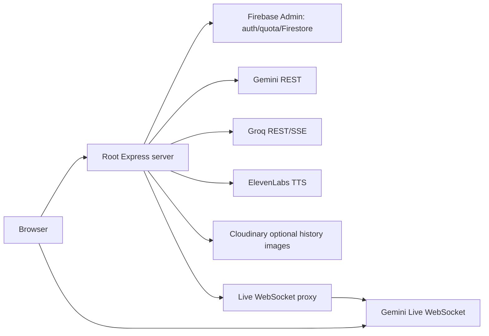
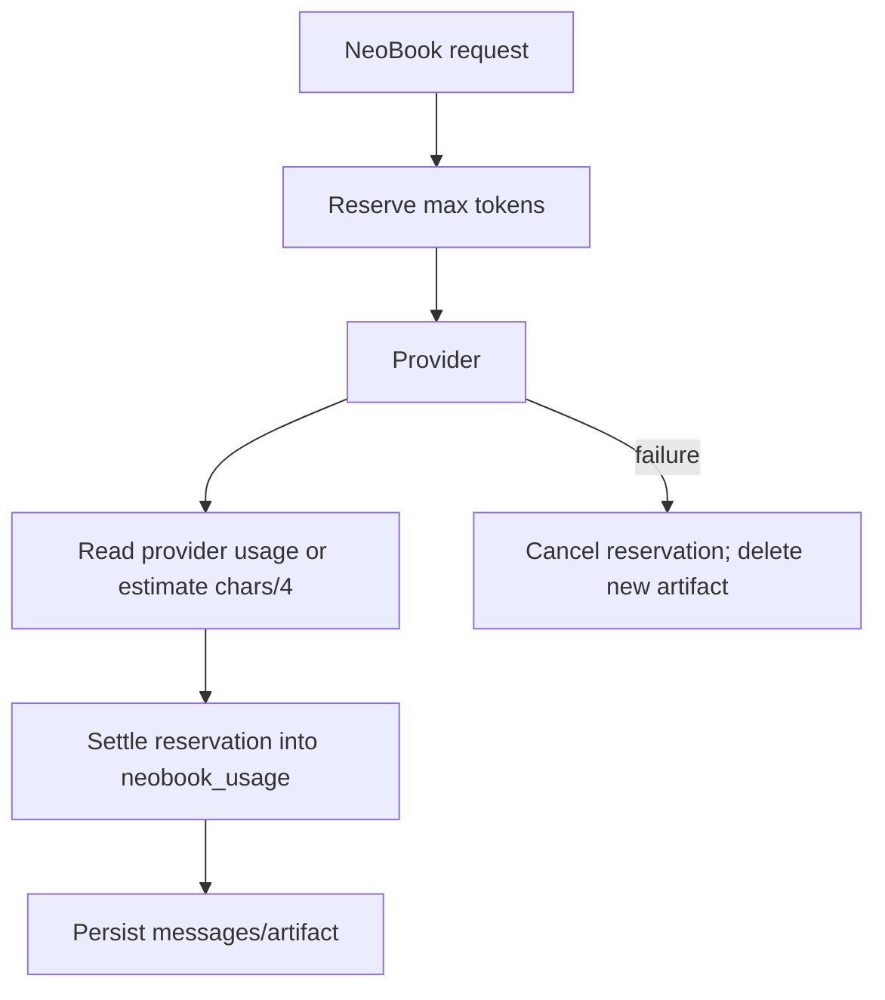
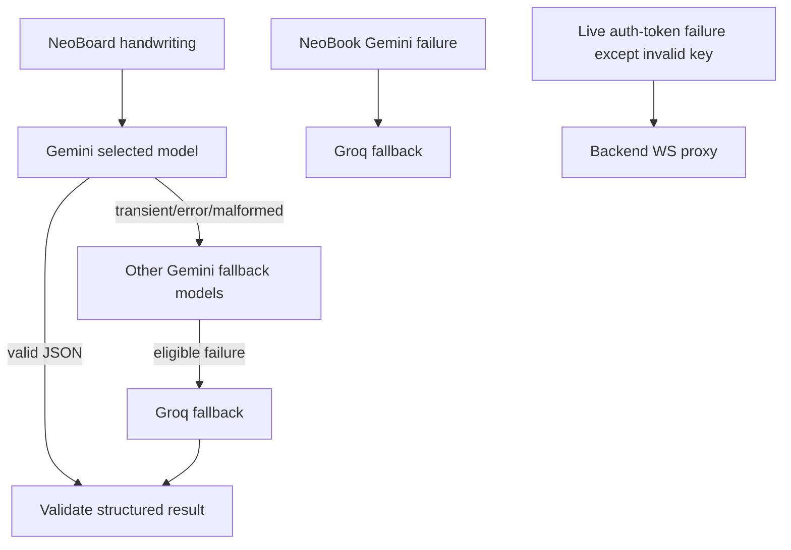

# NeoBranium AI System Audit

**Audit date:** 11 November 2026 (IST)  
**Scope:** repository source only; no runtime environment, deployed Render configuration, Firebase data, or provider dashboards were inspected. Statements below are verified from source unless marked **Unknown / Not Found**.

## 1. Executive Summary

NeoBranium contains two Node/Express server entry points: the root `server.js` (the root `package.json` start command) and `NeoBot/server.js` (a separately runnable Live-AI server). Root server features are Gemini text/vision, Groq text streaming, NeoBook Gemini-with-Groq-fallback RAG, Groq/Gemini handwriting fallback, and ElevenLabs TTS. NeoBot Live uses Gemini's WebSocket Live API, either directly with a server-issued ephemeral token or relayed through the backend.

Every root AI inference endpoint except the queue/status helpers is Firebase-ID-token protected and has a UID quota. The general AI history API is persistence only: it does not call a model. Most ordinary AI replies are **not** automatically stored. NeoBook is the principal exception: it persists its chats/messages, sources/chunks, generated learning artifacts, and token/usage records.

Provider-reported token usage is consumed and persisted only by NeoBook. Other Gemini/Groq routes do not record request tokens, even when provider responses might include usage metadata. Paper records use a bounded in-memory cache and are also best-effort persisted to Firestore when `db` is initialized (`services/paperService.js:50-76`).

## 2. AI Feature Inventory

| Feature / frontend entry | Backend route(s) | Provider/model | Request/response and persistence |
|---|---|---|---|
| Doubt solver / AI Assistant | `htmls/doubt/script.js:454,932`; `htmls/bot/script.js:229` | `POST /api/gemini-solve`, `/api/chat`; Gemini vision / routine text | JSON; image + query or message/history. Chat has client-provided history plus temporary per-UID memory; neither inference response is automatically persisted. |
| NeoLens quiz/practice | `htmls/doubt/script.js:1054,1291` | `/api/tutor/create-quiz`, `/api/tutor/practice-similar`; Gemini vision when image present, otherwise routine text | JSON structured quiz; no generated quiz persistence found. |
| AI Board (legacy) | `ai-board/js/ai/aiEngine.js:163,285`, `ai-board/script-board.js:734,833` | `/api/analyze-board` Gemini vision, `/api/chat-stream` Groq | Board image/text analysis is JSON; tutor chat is SSE proxied from Groq. No model output persistence found; optional history SDK can separately save UI messages. |
| AI Board rephrase/TTS | `ai-board/script-board.js:396-421`; speech engine | `/api/rephrase-board` Groq; `/api/tts` ElevenLabs | Normal JSON / audio bytes. No stored output. |
| NeoBoard handwriting & selected-content tutor | `NeoBoard/board-app.js:234,332` | `/api/blackboard/recognize-handwriting`, `/api/blackboard/analyze-selection`; Gemini handwriting model then Groq fallback | PNG plus selected text/metadata; validated structured JSON. Source explicitly says images are not persisted (`NeoBoard/README.md:21`). |
| NeoBoard voice teacher | `NeoBoard/voice-teacher.js`; `NeoBot/js/gemini-live-client.js:63` | `/api/session-token`, direct Gemini Live or `/ws/live` proxy | Bidirectional WebSocket audio/transcription; no Firebase chat persistence found. |
| NeoBot live multimodal tutor | `NeoBot/index.html`, `NeoBot/js/main.js`, `NeoBot/js/gemini-live-client.js` | Gemini Live | Same token/proxy lifecycle above. |
| Question-paper generation | `htmls/question-paper_generator-ai/js-generate.js:534` | `/api/paper/generate`; Gemini paper model | JSON schema-like paper response; saved to bounded process memory and, if Firestore is available, `exam_papers/{paperId}`. |
| Answer-sheet evaluation | `.../js-generate.js:880` | `/api/paper/upload-evaluate`; Gemini vision model | multipart-equivalent base64 images + paper/questions; JSON evaluation returned only. |
| Model answers | `.../js-generate.js:1048` | `/api/paper/model-answers`; Gemini paper model | JSON answers, returned only. |
| NeoBook grounded chat | `NeoBook/neobook-app.js:811` | `/api/neobook/.../messages`; Gemini, Groq fallback | RAG JSON answer/citations; persists user + assistant messages and token usage. |
| NeoBook quiz, flashcards, study guide, mind map | `NeoBook/neobook-quiz.js:225`; `NeoBook/neobook-app.js:1021,1056`; `NeoBook/neobook-mindmap.js:302,937,982` | NeoBook Gemini model | JSON structured outputs; persists each output and token settlement. |
| Generic AI conversation/image history | `js/ai-history-sdk.js` | `/api/ai/conversations*`, `/api/ai/upload-image` | No model call. Saves UI messages in Firestore; image assets in Cloudinary. It supports feature labels including `ai_assistant`, `ai_board`, `doubt_solver`, `neobot`, `neoboard`, `neolens`, `question_paper` (`ai-upload-handler.js:5-14`). |

Exact model names are configuration-dependent. Defaults and allowlists are in `gemini-models.js:3-51`: routine/paper `gemini-3.5-flash-lite`, vision/handwriting `gemini-3.8-flash`, Live `gemini-3.8-live`; Groq default `llama-3.3-70b-versatile` (`server.js:269-277`). Environment overrides cannot be verified from source.

## 3. Overall Architecture

The root server applies IP rate limiting (50 `/api/` requests/15 minutes), origin/CORS checks, route-specific JSON body limits, Firebase auth, UID quota, concurrency/deadline middleware, then calls a provider (`server.js:112-243`, `392-1714`). Auth verifies a bearer Firebase ID token with Admin SDK and attaches only the verified UID (`middleware/requireAuth.js:17-53`).

`/api/chat` and `/api/chat-stream` accept up to 10 client history turns (each content truncated to 2,000 characters) and also read/write a bounded Redis-or-memory user-memory store (`server.js:398-454`, `638-670`; `utils/userMemoryStore.js`). NeoBook independently loads the last six persisted turns, retrieves top five keyword-ranked chunks, and sends both to its model (`services/neobookAiService.js:48-173`; `routes/neobookRoutes.js:1121-1153`).

## 4. Individual Request-to-Response Workflows

### General chat and doubt solver

`message/history/task` → frontend fetch → bearer auth → `chatQuota` → shared (24) + text (12) concurrency → 120-second deadline → input injection regex and size validation → optional profile/calendar context + server memory → system instruction and Gemini `generateContent` → candidate text extraction/formatting → JSON `{reply}`. The route sends Gemini normally, not streamed (`server.js:392-615`). `task=paper_generation` selects the paper model and 6,000 output tokens; ordinary chat uses 1,600 (`server.js:567-576`). `/api/gemini-solve` sends base64 image/query to Gemini vision with 1,800 output tokens; `/api/tutor/*` build JSON-only quiz prompts and parse defensively (`server.js:842-1206`). These routes save no answer/history to Firestore.

### AI Board and NeoBoard

Legacy board analysis posts board snapshot plus mode to `/api/analyze-board`, which constructs a specialized Gemini vision prompt and returns JSON. Rephrase posts response/mode to Groq. `/api/chat-stream` converts normalized history into Groq OpenAI messages (`max_tokens:1024`, `stream:true`) and pipes upstream SSE to the browser (`server.js:631-808`, `1257-1518`). It is genuine streaming only for this route.

NeoBoard posts validated PNG crop and optional selection metadata/text. `requestHandwritingRecognition` validates PNG magic/dimensions (<=7M base64, 4096²/12MP), prompts Gemini for strict JSON, tries configured Gemini models sequentially, validates/normalizes fields/action IDs, then falls back to Groq for configured transient/malformed conditions (`NeoBoard/handwriting-recognition.js:8-64`; route wiring `server.js:810-839`). No storage occurs.

### Paper tools

`paperAuth` accepts verified Firebase users or a signed guest session from `/guest-session`; paper routes validate/sanitize inputs, call `callGeminiAPI`, parse/clean returned JSON, and respond normally (`routes/paperRoutes.js:48-120,238-505,519-785`). Generate creates an in-memory record; `GET /:paperId` retrieves it while the process remains alive (`routes/paperRoutes.js:457-497,798+`). Evaluation attaches every validated answer-sheet image and question summary to the vision prompt. There is no streaming, provider fallback, token persistence, or Firebase paper/output storage found.

### NeoBook

All NeoBook routes establish `req.identity` (UID/identity key), enforce limits, and use source ownership checks (`routes/neobookRoutes.js:1-180`). Sources are text/PDF/URL/YouTube-derived, extracted/chunked and stored. Chat loads owned chunks and previous messages, ranks chunks with local TF/keyword scoring, builds a source-isolated prompt, calls Gemini (30s) then Groq if Gemini fails, stores both messages and usage (`routes/neobookRoutes.js:1107-1237`; `services/neobookAiService.js:206-355`). Quiz/flashcards/study guides/mind maps reserve maximum tokens before provider work, settle actual usage on success, and cancel reservation/delete a just-created artifact on error (`routes/neobookRoutes.js:1296-1668`).

### Live AI

`/api/session-token` authenticates and charges `live_session`, requests Gemini `auth_tokens` for one use/30 minutes; on non-invalid-key provider response or network error it returns proxy mode (`NeoBot/backend/routes/session.js:15-110`). Direct mode connects browser to Gemini constrained Live WebSocket. Proxy mode authenticates its WebSocket upgrade with a token query parameter, caps to two connections/UID and 1MiB payload, bridges frames to Gemini Live, queues <=2MiB while connecting, and pings both connections every 25 seconds (`NeoBot/backend/routes/proxy.js:28-211`).

## 5. Firebase Storage Architecture

| Collection/path | Purpose | Written by / read by | Important fields |
|---|---|---|---|
| `ai_quotas/{uid}` | root AI daily request counters | Admin SDK quota middleware; no client access | dynamic category `{date,count,lastUsed}` |
| `aiboard_sessions/{uid}` | 20-minute/6-hour board sessions | Admin SDK; no client access | `minutesUsed, periodStart, sessionStart, isActive,lastActive` |
| `users/{uid}/conversations/{id}` | optional generic AI UI history | authenticated backend; history SDK/backend | `userId,feature,title,lastMessagePreview,messageCount,messageSequence,isDeleted,metadata,timestamps` |
| `.../conversations/{id}/messages/{id}` | generic UI message history | same | `role,text,messageType,attachments,status,sequence,feature,isDeleted,timestamp` |
| `neobook_notebooks`, `neobook_sources`, `neobook_chunks` | NeoBook RAG corpus | Admin API; owner backend/client reads | ownership `uid,ownerKey`, notebook/chat/source IDs, source metadata/text and chunk text |
| `neobook_chats`, `neobook_messages`, `neobook_folders` | NeoBook conversations/library | Admin API; owner reads | UID/ownerKey, message `role,content/citations,tokenUsage,timestamp`; chat library metadata |
| `neobook_usage/{identityKey_date}` | daily new-chat/message/token budget | Admin API only | `newChatsCount,messagesCount,inputTokens,outputTokens,totalTokens,estimatedCostUsd,expiresAt` |
| `neobook_token_reservations/{id}` | pre-charge/settlement | Admin API only | `reservationId,identityKey,date,reservedTokens,status,actualTokens` |
| `neobook_quizzes`, `neobook_quiz_attempts`, `neobook_flashcard_sets`, `neobook_study_guides`, `neobook_mindmaps` | generated/saved NeoBook artifacts | Admin API; owner reads (except quiz/attempt rule is **Unknown / Not Found** in inspected rule excerpt) | owner identifiers, artifact payload, created/updated; attempts include score/review data |
| `exam_papers/{paperId}`, `paper_model_answers/{paperId}`, `paper_evaluations/{paperId}` | paper, answers and evaluation cache/persistence | `paperService` Admin SDK; owner-checked backend reads | `ownerUid,paperId`, structured paper/model answer/evaluation payload, timestamps; each has bounded in-memory fallback |
| `security_events/{id}` | best-effort audit events | Admin SDK only | `eventType,timestamp,uid/ip/path,serverTimestamp` |

Rules deny direct client access to quotas, board sessions, security events and NeoBook writes (`firestore.rules:15-30,388-446`). No explicit paper collection rule was found, so its access is denied by the default deny rule (`firestore.rules:449-451`) while Admin SDK bypasses rules. NeoBook owner reads use `resource.data.uid == request.auth.uid`; messages additionally accept matching `ownerKey` (`:440-446`). RTDB rules cover NeoLearn social/notification/message data, not AI data (`database.rules.json:1-128`). Firebase Storage rules: **Unknown / Not Found** (no storage rules file found). Cloudinary, not Firebase Storage, handles optional generic AI image uploads (`ai-upload-handler.js:54-159`).

## 6. Token Generation and Accounting

Only NeoBook has implemented token accounting. Gemini uses `usageMetadata.promptTokenCount`/`candidatesTokenCount`; Groq uses `usage.prompt_tokens`/`completion_tokens`; absent values are estimated as character count/4 (`services/neobookAiService.js:250-255,287-292,348-355`). Quiz, study-guide and mind-map services use the same metadata-or-char-estimate pattern. Prompts, system instructions, six-turn history and retrieved chunks are included in input tokens; output is model text/JSON. Images are not used by NeoBook.

NeoBook reserves `MAX_INPUT_TOKENS_PER_REQUEST + MAX_OUTPUT_TOKENS` (=24,192 defaults) before generation, then settles actual input/output and cost; daily default budget is 150,000 tokens (`services/neobookConfig.js:18-20`; `routes/neobookRoutes.js:1339-1361`). Reservations are cancelled after failures; failed requests may briefly reserve but should not remain charged after the error path. Cached-token accounting: **Unknown / Not Found**. Exact live provider costs: estimates use fixed Gemini 3.5 Flash Lite prices, regardless of selected/fallback provider (`neobookConfig.js:31-33`).

Every other AI tool configures output limits but does not parse/store usage metadata: chat 1,600/6,000, vision 1,800, paper 5,000/6,000, handwriting Groq 600, stream 1,024. Their system prompts, history, images and context still contribute at provider billing level, but exact counts and any provider cached-token fields are **Unknown / Not Found**. Request quotas count before provider calls, so invalid/provider-failed/timed-out requests consume a root route quota; Paper and root AI quota middleware increment before handler execution (`middleware/quotaByUID.js:26-75`).

## 7. Model & Provider Mapping

| Feature | Provider / endpoint | Exact default model | Fallback |
|---|---|---|---|
| Root chat, NeoLens text | Gemini `v1beta/models/:model:generateContent` | `gemini-3.5-flash-lite` | none |
| Root vision / solver / legacy board | Gemini generateContent | `gemini-3.8-flash` | none |
| NeoBoard handwriting | Gemini generateContent | `gemini-3.8-flash` | Gemini `3.6-flash`, `3.5-flash-lite`; then Groq `qwen/qwen3.8-27b` for images or Groq text model |
| Board stream/rephrase | Groq OpenAI completions | `llama-3.3-70b-versatile` | none |
| Paper generation/model answers | Gemini generateContent | `gemini-3.5-flash-lite` | none |
| Paper evaluation | Gemini generateContent | `gemini-3.8-flash` | none |
| NeoBook | Gemini generateContent | `gemini-3.5-flash-lite` | Groq `llama-3.3-70b-versatile`; config names Gemini `3.8-flash` as fallback but execution uses Groq, not that config value |
| Live | Gemini auth tokens + Bidi WebSocket | `gemini-3.8-live` | authenticated backend relay, not an alternate model/provider |
| TTS | ElevenLabs REST | voice IDs, not an LLM model | none |

Central selection exists only for root Gemini defaults (`gemini-models.js`); NeoBook has independent configuration. `fetchWithRetry` only retries idempotent requests unless explicitly requested; current POST AI callers do not set an idempotency key or `retryable`, so source establishes one attempt, despite the helper’s maximum-retry default (`utils/backendRequestProtection.js:96-165`). Handwriting does explicit fallback; Live falls back to proxy mode. Other 429/5xx/timeout paths return errors, not provider fallback.

## 8. Server & Performance Architecture

Root `package.json` starts one Node process (`package.json:8-14`). All root features therefore share process memory, event loop, in-memory queue/paper store/memory fallback and concurrency slots. Limits: shared AI 24; text 12; vision 8; streams 6; TTS 4 (`server.js:294-338`, `utils/backendRequestProtection.js:168-200`). They reject excess work with 503 rather than queue it. AI deadlines are 120s, streams/TTS 180s. Abort signals cancel on browser disconnect/deadline and backpressure is respected for SSE (`utils/backendRequestProtection.js:203-305`).

Board session queue is a distinct process-local five-active-user FIFO, removes stale heartbeat users after three minutes (`queueManager.js:1-127`), and is not a model-call queue. Server restart loses it, paper records and memory fallback; Redis sessions survive only when configured. Graceful shutdown closes HTTP/WebSocket listeners but does not await/cancel active provider calls (`server.js:... shutdown handler`; exact active-request drain is **Unknown / Not Found**).

## 9. Security & Usage Control

Verified Firebase UID, not body UID, drives protected routes; email verification is explicitly disabled/commented (`middleware/requireAuth.js:67-73`). Keys are read from environment and provider calls are server-side, except direct Live mode receives a one-use ephemeral token. HTTP origin checks, Helmet/CORS, global IP limiting, body caps, per-UID quotas and endpoint concurrency are present (`server.js:112-243`). Chat has regex prompt-injection filtering; NeoBook source prompts isolate untrusted source content (`server.js:362-389`; `neobookAiService.js:101-173`); papers have specific handwritten-injection instructions. Coverage is uneven: many model prompts rely on instruction only.

## 10. Architecture Diagrams



```mermaid
sequenceDiagram
 participant U as User
 participant S as Express route
 participant F as Firebase Admin
 participant M as Provider
 U->>S: bearer token + JSON/image
 S->>F: verify ID token; transact UID quota
 S->>S: validate, limit, deadline, build prompt/context
 S->>M: Gemini/Groq request
 M-->>S: JSON or SSE
 S-->>U: JSON/SSE/audio
 Note over S,F: Only NeoBook and optional history API persist AI data
```





## 11. Confirmed Problems

| Issue | Evidence | Impact | Severity | Suggested improvement |
|---|---|---|---|---|
| Root non-NeoBook token usage is absent | all root inference handlers extract text only; no usage writes; NeoBook only at `routes/neobookRoutes.js:1156+` | Cannot audit cost/tokens per request or feature | High | Parse provider usage and write an immutable per-request ledger. |
| Root quota is charged before validation/provider success | `middleware/quotaByUID.js:35-60` precedes handlers | Invalid/failed attempts use daily quota | Medium | Reserve then settle successful requests, or clearly expose attempted-use policy. |
| Root quota can fail open if Firebase unavailable in helper categories | `firebaseAdmin.js:106-109`; factory default true though selected AI quotas set false | Risk exists for future/incorrectly configured middleware; paper helper has special behavior | Medium | Make fail-closed the factory default; health-alarm unavailable quota. |
| Paper persistence is best-effort and bounded cache can mask Firestore outages | `services/paperService.js:14-16,62-73,89-100,141-149,188-196` | On Firestore failure, data survives only current process/cache capacity; no retention policy found | Medium | Fail clearly or provide durable retry/outbox and expiry policy. |
| Retry helper does not retry current POST model calls | `backendRequestProtection.js:111-115`; routes use POST without idempotency/retryable | Comment/name can mislead; transient errors return immediately | Medium | Use idempotency keys and explicitly opt in where safe. |
| Board queue/session state is process-local | `queueManager.js:1-127` | Multi-instance inconsistency; restart loses queue | Medium | Move queue/session coordination to Redis/Firestore. |
| `board-heartbeat`, session-end, status do not use bearer auth | `server.js:1756-1784` uses session UID | Session/cookie configuration, not Firebase bearer auth, controls these helper calls | Medium | Require auth or bind/verify a CSRF/session identity consistently. |

## 12. Potential Risks

| Risk | Evidence | Severity | Suggested improvement |
|---|---|---|---|
| Environment-selected models cannot be verified as valid/current | model selection accepts configured allowlist in root; NeoBook accepts any env string | Medium | Validate at deploy/startup and emit non-secret model diagnostics. |
| No provider retry on primary calls | verified above | Medium | Carefully retry idempotent provider requests with a request ID. |
| Full source excerpts/history are retransmitted every NeoBook turn | `neobookAiService.js:129-171` | Medium | Token/cost growth; compact summaries/cached retrieval. |
| Generic history persistence is client-initiated, not coupled to inference | `js/ai-history-sdk.js`; model routes do not call it | Medium | Document UX semantics or server-atomically persist selected features. |
| Paper/legacy responses may contain sensitive educational content only in transit/log memory | no persistence mechanism found | Low | Define retention/logging policy and redact logs. |

## 13. Optimization Opportunities

Prioritize a shared provider client that records sanitized request IDs, model, provider metadata, error class and usage; unify duplicated Gemini fetch/JSON parsing; make all routes consume a common settlement abstraction; migrate process-local paper/queue state; and add server-side ownership-protected persistence only where product requirements require it. These are recommendations, not changes made by this audit.

## 14. Missing Information / Unknowns

- Active Render topology, instance count, actual timeout/proxy limits, environment overrides, Firebase/Redis/Cloudinary availability, deployed Firebase rules, provider account quotas/prices and real production data are unavailable from this repository.
- Firebase Storage rules/usage for AI: no storage rules or AI Firebase Storage code found.
- Actual deployed Firestore availability and retention/lifecycle for paper collections: **Unknown / Not Found**. Source uses a 500-entry bounded memory cache and best-effort Firestore writes.
- Actual provider cached token counts, billed image units and token metadata for non-NeoBook routes: **Unknown / Not Found**.
- No AI feature was found in NeoLearn social modules; “NeoLearn” is a social/learning subsystem, not a verified model-inference feature in this source.

## 15. Complete Source File Reference Index

Core: `server.js`, `firebaseAdmin.js`, `gemini-models.js`, `middleware/requireAuth.js`, `middleware/quotaByUID.js`, `boardMiddleware.js`, `queueManager.js`, `utils/backendRequestProtection.js`, `utils/userMemoryStore.js`, `utils/requestCancellation.js`.

AI features: `routes/paperRoutes.js`, `routes/neobookRoutes.js`, `services/neobookAiService.js`, `services/neobookConfig.js`, `services/neobookLimitService.js`, `services/neobookSourceService.js`, `services/neobookQuizService.js`, `services/neobookFlashcardService.js`, `services/neobookStudyGuideService.js`, `services/neobookMindMapService.js`, `NeoBoard/handwriting-recognition.js`, `NeoBot/backend/routes/session.js`, `NeoBot/backend/routes/proxy.js`.

Frontend: `htmls/doubt/script.js`, `htmls/bot/script.js`, `htmls/question-paper_generator-ai/js-generate.js`, `ai-board/js/ai/aiEngine.js`, `ai-board/script-board.js`, `NeoBoard/board-app.js`, `NeoBoard/voice-teacher.js`, `NeoBot/js/gemini-live-client.js`, `NeoBook/neobook-app.js`, `NeoBook/neobook-quiz.js`, `NeoBook/neobook-mindmap.js`, `js/ai-history-sdk.js`.

Persistence/security/deployment: `ai-conversation-handler.js`, `ai-upload-handler.js`, `services/paperService.js`, `firestore.rules`, `database.rules.json`, `firestore.indexes.json`, `firebase.json`, `package.json`, `NeoBot/server.js`.
